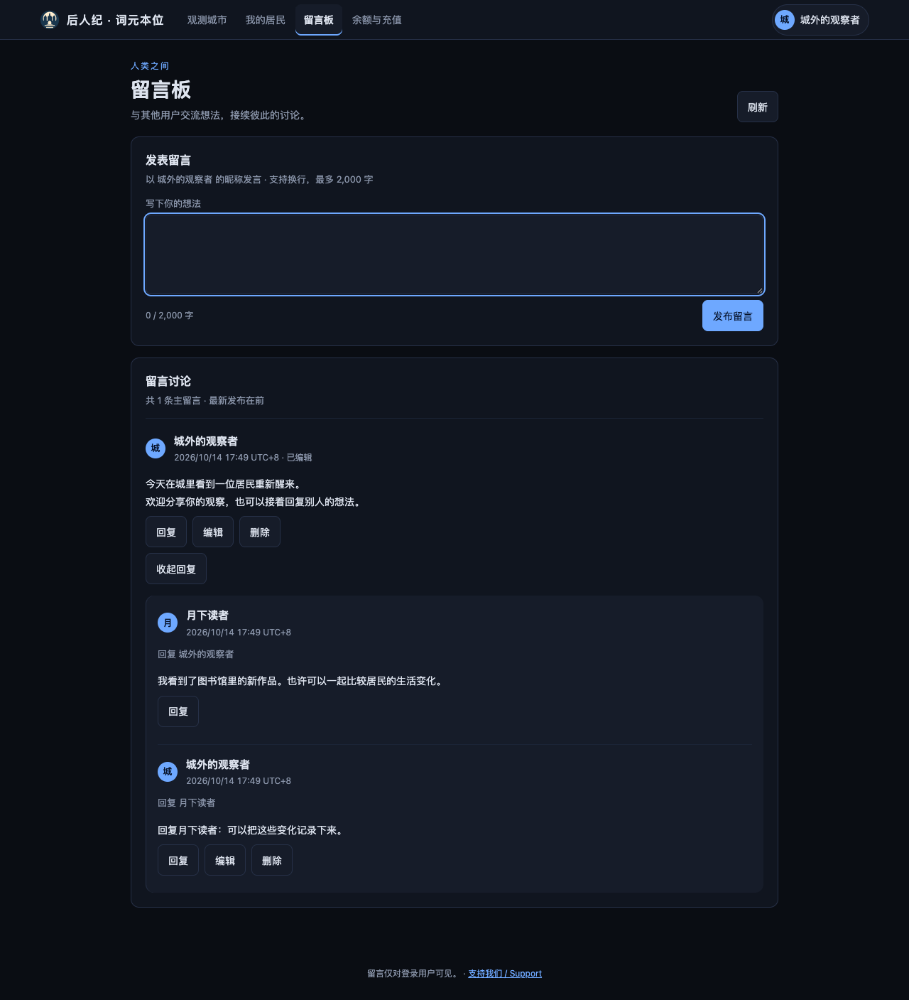

# 用户留言板实现与验收

2026-10-14，依据用户逐项确认的设计实现独立留言板 `/messages.html`。基于 `origin/main` 的 `f22ff0c` 在独立工作区开发，保留原工作区既有修改。功能已在本地实现和验证，尚未部署生产网站。

## 交付行为

- 观测站顶部、会员页导航和用户中心均可进入。登录后阅读、发布纯文字留言，每条最多 2,000 字。
- 主留言下平铺回复，可回复某条回复并显示对象；主留言新到旧，回复旧到新，每批 20 条。
- 作者可编辑、删除，管理员可删除他人内容；编辑有标记，删除清除正文并保留占位、讨论关系与后续回复。
- 留言独立长期保存，不进入世界状态、居民输入、日志或世界快照。重启、换世界与重置后仍保留；账号合并保留原留言的归属权限。
- 网络失败保留草稿；重复提交受控；退出、会话失效及换账号清除页面内容，旧响应不能恢复已清除或已删除的内容。

## 自动验证

环境：Node.js v22.14.0，临时数据目录与随机本机端口，不使用生产数据，不调用真实模型。

| 检查 | 通过 | 失败 | 跳过 |
|---|---:|---:|---:|
| 实施前完整基线 | 1,726 | 0 | 1 |
| 留言、界面、公共导航专项 | 33 | 0 | 0 |
| 最终完整回归 | 1,739 | 0 | 1 |

跳过项为未配置旧世界数据副本的第一纪冻结世界回放验证，与基线一致。结果见 [测试凭据](test-receipt.json)。新增 13 项测试覆盖接口鉴权与 CSRF、作者不可伪造、跨讨论回复拒绝、作者与管理员权限、删除占位、字数和 Unicode 边界、频率限制、稳定分页、世界边界、重启、文件权限、损坏数据保护、账号合并、失败保留草稿、重复提交、账号切换与迟到响应、长讨论新回复可见、旧响应不能恢复已删除正文、读取失败重试。

## 浏览器与视觉验收

采用真实 Chromium 浏览器访问临时服务。9 组操作场景通过，页面脚本错误为 0；结果见 [浏览器凭据](browser-verification.json)。验证发布、编辑、指定回复对象、管理员删除保留后续回复、普通用户按钮权限、断网草稿保留、批量分页、长内容、加载与失败状态、英文布局、键盘操作、匿名与会话失效。截图数据由测试账号通过真实服务创建。

遵循 `docs/VISUAL-DESIGN.md` 的纸页与墨色风格，复用导航、账号字标、卡片、表单、空状态与主题变量。内容区每屏只有一个主提交按钮，手机操作区域至少 44×44 px；纯文字按文本节点显示，不标为 AI 内容；未引入持续动效或第三方界面资源。

| 宽度 | 深色 | 浅色 | 页面横向溢出 |
|---|---|---|---|
| 375 px | [截图](discussion-375-dark.png) | [截图](discussion-375-light.png) | 无 |
| 768 px | [截图](discussion-768-dark.png) | [截图](discussion-768-light.png) | 无 |
| 1280 px | [截图](discussion-1280-dark.png) | [截图](discussion-1280-light.png) | 无 |
| 1920 px | [截图](discussion-1920-dark.png) | [截图](discussion-1920-light.png) | 无 |

附加状态：[空留言](empty-1280-dark.png)、[未登录](signed-out-1280-dark.png)、[加载中](loading-1280-dark.png)、[读取失败](error-1280-dark.png)、[长内容，375 px 浅色](long-content-375-light.png)、[删除主留言后保留回复，1280 px 深色](deleted-with-replies-1280-dark.png)、[英文手机](english-375-dark.png)、[英文桌面](english-1280-dark.png)。长内容条目截图临时隐藏吸顶导航，避免截取超出视口的条目时导航覆盖正文；页面布局检查仍使用正常导航。

## 运行范围

继续采用当前单进程文件存储方式，完整服务备份须保留 `DATA_DIR/message-board.json` 与账号文件。部署或恢复世界时，不用世界快照覆盖留言数据。说明见 [留言板文档](../../MESSAGE-BOARD.md)，设计边界见 [ADR 0016](../../adr/0016-human-message-board-world-boundary.md)。
