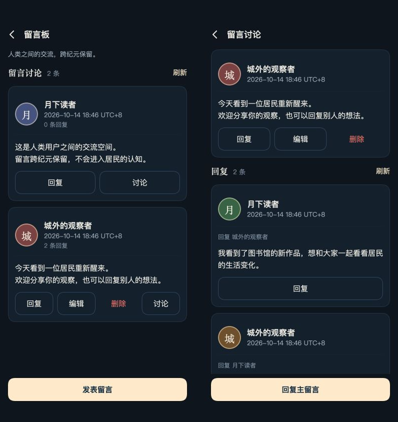

# 微信端人类留言板验收

2026-10-14。用户授权网页版合并并推送 GitHub，然后扩展小程序。网页版及单行操作按钮已合并到 main：`ee9082bdffcd7a64857d38a548c65a266dd6a9d1`。小程序基于该提交实现，普通小程序版本为 0.5.0。

## 交付行为

“我的 → 留言板”进入独立列表；讨论详情平铺回复并标明回复对象。可发表、回复、编辑本人内容和确认删除，管理员可删除他人内容。删除保留讨论与回复，最长 2,000 个 Unicode 字符，分页沿用网页游标。数据使用已有独立留言文件，跨纪元保存，微信端与网页共用账号权限及讨论。

微信专用路由要求网站会话和对应 AppID 微信身份，发布及编辑检查昵称与正文，异步检查之后再核对会话。读取只投影用户文字，未检查的文字不发送；编号、时间、游标与权限完整。精确文本摘要缓存避免旧检查批准新文字或检查期间变化的昵称。退出、换账号和身份失效清除内容及草稿，晚到读取/提交不能回填。冷启动仍由原确认页守住首次联网。

按 `docs/VISUAL-DESIGN.md` 复用月下城 Canvas 卡片、系统正文、衬线固定标题和月白主按钮。每条消息操作单行，长正文可展开，点按区域至少 44×44。原生多行输入层统一使用同一色板。小游戏优先加载本地宋体子集；普通小程序没有同步字体接口时使用系统衬线标题，动态名字和正文仍用系统字体。

## 本地验证

最终全量 1,752 项：1,751 通过、0 失败、1 跳过（缺少第一纪冻结数据副本）；留言板最终专项 11 项通过。完整结果见 [验证回执](verification.json)。新增测试覆盖微信身份与检查、同源数据、回复边界、越权、检查期间退出、投影不改原文、文本摘要缓存、草稿和忙碌状态、旧账号晚到读写、字数与未展示内容、大字布局。已有真实本地 P6 HTTP/Canvas 集成同时覆盖小游戏源代码和普通小程序生成运行目录的发表、回复、编辑、删除、失败草稿与退出。

普通小程序离线检查和构建通过，2 个页面、40 个文件；构建目录为 `wechat/build-miniprogram/`。构建只同步客户端依赖，不含世界、账户数据、密钥或本地预览服务；未执行上传或生产部署。

## 视觉检查

截图来自本地临时预览，复用真实共享 Canvas 页面、控制器及普通小程序平台适配层，使用独立示例账号/留言和模拟内容检查。浏览器截图不是微信真机截图。画面中的模拟说明保留在完整页面截图里；下面的两屏裁剪仅去掉预览工具外围。预览服务仅监听本机，不连接生产。

- iPhone SE 375×667：[列表](list-se-page.png)、[书写](new-se-page.png)。
- iPhone 15 390×844：[列表](list-page.png)、[讨论](thread-iphone15-page.png)、[书写](new-iphone15-page.png)。
- 安卓 393×851：[列表](list-android-page.png)、[大字](list-android-large-page.png)、[长正文](long-android-page.png)。
- [我的入口](my-android-page.png)、[回复](reply-android-page.png)、[编辑](edit-android-page.png)、[删除确认](delete-android-page.png)。
- [空列表](empty-android-page.png)、[加载](loading-android-page.png)、[错误与重试](error-android-page.png)、[未登录](anonymous-android-page.png)。
- [原生输入层模拟](native-input-android-page.png)、[输入结束后的多行内容](native-input-result-page.png)。

已逐项查看截图：没有文字重叠，列表/回复在滚动区域内，底部提交按钮固定，普通及大字操作均保持一行；无权限按钮不出现；输入层保留换行。字号和键盘由浏览器模拟，真实平台字体、键盘遮挡、安全区及触摸须在微信开发者工具和真机验收。

本次未执行真实微信登录或真实内容安全服务调用，未向微信上传或发布，未部署生产服务器；上述平台验收仍待执行。
