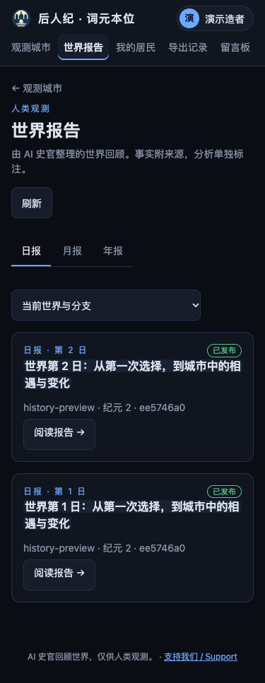
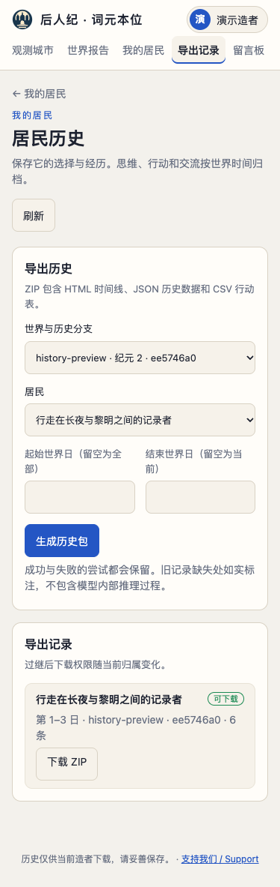
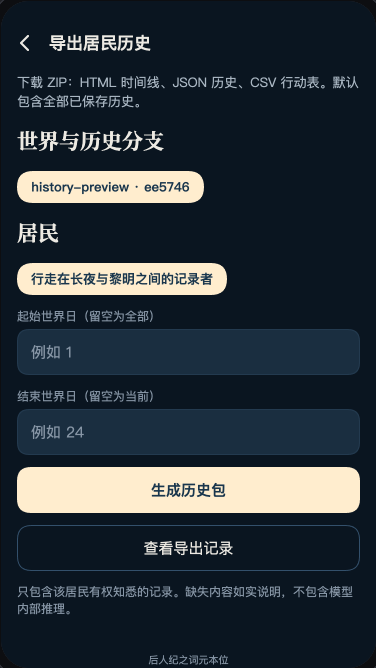

# 世界报告与居民历史验收记录

日期：2026-10-15。实施分支：`codex/world-reports-history`，基于 `origin/main` 的 `3ea9b83`，独立工作区保留原工作目录的未提交修改。功能和入口见 [使用与运维说明](../../HISTORY.md)，设计依据见 [已确认方案](../../plans/2026-10-15-world-reports-resident-history-design.md)。

## 完成范围

世界日报、月报和年报按世界时间排队生成，使用独立 AI 史官配置及额度。报告分开呈现事实、分析和来源；私人日记、家书、尚未公开的事件及模型身份不进入素材，报告不进入居民感知或记忆。支持额度等待、有限重试、管理员补生成和未满一年标记。

当前持有人可以发起全历史或指定世界日范围的 ZIP 导出，包含离线 HTML、JSON 和行动 CSV。记录实际成功及失败动作、已保存的思维文字、状态和相关交流，不提供内部推理。下载再次核验归属，过继前提示私人历史移交；匿名收件隐藏来者身份，被屏蔽的私语不作为收件历史。独立归档保留旧世界与回滚分支，缺失记录如实说明。

网页沿用纸页工作台和共用组件；微信小程序与小游戏共用月下城 Canvas 组件。增加观测站、居民详情、导出记录及管理后台入口。

## 自动化验证

| 检查 | 结果 |
|---|---|
| 完整 `npm test` | 1,799 项，1,798 通过，0 失败，1 跳过，约 160 秒 |
| 新增后端专项 | 17 项全部通过，包含公开时间、匿名及屏蔽私语、失败动作、重复传输、过继撤权、账号合并、回滚分支、旧世界只读接入、引用校验、额度与密钥保护 |
| 网页与微信相关专项 | 92 项通过；随后新增匿名私语专项并纳入完整回归 |
| 最终微信专项 | 57 项全部通过，包含登录回调隔离和成功后再次导出取得新快照 |
| 微信小程序离线检查 | 2 个页面、42 个文件，结构及 JavaScript 语法通过 |
| Canvas 小游戏离线检查 | 31 个文件，结构及 JavaScript 语法通过 |
| 下载文件 | 实际从网页发起、下载并解压；4 个文件 CRC 正确，CSV 行动条数与 JSON 一致，HTML 无脚本或外部资源 |
| 变更格式检查 | `git diff --check` 通过 |

跳过的项目为第一纪冻结世界回放测试：环境没有设置 `HOUREN_FROZEN_WORLDS`，未提供指定世界的数据副本。其他两代引擎、账号、服务和现有微信测试均执行。结构化结果见 [验证结果](validation.json) 与 [ZIP 校验](zip-validation.json)。

## 页面验证

全部使用临时演示世界和测试账号。报告正文由受控测试提供者返回，没有调用计费模型，也没有读取生产居民或账号。通过真实浏览器登录、发起导出和下载文件；空、错误、长列表等状态使用浏览器拦截提供演示响应。微信预览使用本地显式演示数据，不能视为真机登录或原生文件保存的验收。

| 页面或状态 | 尺寸与主题 | 证据 |
|---|---|---|
| 报告列表、全文、导出页、管理面板 | 375 / 768 / 1280 / 1920，深色及浅色，共 32 张截图 | [布局记录](browser-results.json) |
| 中英文、月报空列表、导出空状态、错误重试、普通账号无管理权限、长标题 30 条列表与分页 | 375，英文另看 1920 | [附加记录](extra-browser-results.json) |
| 加载状态与触控尺寸 | 375，深色；刷新、类型筛选与分支选择均为 44px | [加载与触控记录](loading-browser-results.json) |
| 离线时间线 | 375 / 1280，深色及浅色，实际使用解压文件 | [离线截图](offline-375-light.png) |
| 微信报告列表、报告全文、导出表单、导出记录 | SE 375×667 / iPhone 15 390×844 / 安卓 393×851 | [微信预览记录](wechat-browser-results.json) |

浏览器记录中无页面脚本异常，检查过的网页宽度均满足 `scrollWidth <= clientWidth`。长标签和长正文保持在容器内；生成表单保留一个主操作。微信共用筛选标签及小节链接的触控区域至少为 44px，新增宋体标题已重新生成字库子集。人工查看了网页列表、报告、管理面板、导出页、英文页，以及微信报告与导出表单和离线时间线。

网页报告列表，375px，深色：

网页历史导出，375px，浅色：

微信导出表单，375×667，月下城主题：

## 发布前仍需的环境验证

本次没有部署生产环境。管理员需要配置实际 AI 史官线路与额度后才会调用真实模型；本次验证不证明特定外部模型的生成质量、计费回执或网络可用性。

微信开发者工具编译、真机微信身份和内容检查、平台下载域名配置，以及原生保存或分享 ZIP，仍需在微信发布环境验证。离线结构检查、浏览器 Canvas 预览和会话防串号测试已通过，不能代替这些环境验证。

备份须保留独立 `history-archives` 目录、加密配置及密钥。旧版本未保存的结果与已经删除的私人原始资料无法恢复，文件中会标注缺失；报告引用经过结构校验，AI 事实表述仍可通过历史来源核对。
