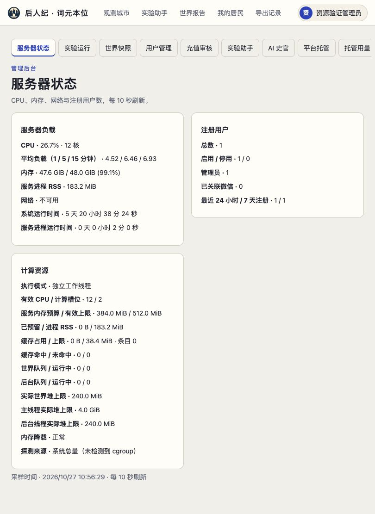

# 在线资源适配验证记录

日期：2026-10-27。实现分支：`codex/adaptive-online-compute`；基础提交：`609fd27245b1e95e4a9957a685c04827e5f4bebf`。本次交付为代码、配置说明与验证记录，未部署或修改生产世界。

本记录及原始摘要清单对应首批实现 `9c55e5f`。后续生产验收发现批量唤醒的版本衔接问题，已保留进展恢复旧代码，并补充 [修复与回归说明](../../fixes/2026-10-27-batched-session-admission.md)。原合成基准未覆盖该启动负载，不能替代最终上线验收；原始记录保持不变。

## 实现范围

- 常驻世界计算线程按序准备候选及回执，主线程作为唯一落盘协调者；确认提交后增量更新查询镜像，保持原有事件发布顺序。复用已提交状态哈希，避免下一条命令再次计算相同的前置哈希。
- 独立线程池承担固定历史边界的检索、ZIP 导出、快照压缩与哈希；按 CPU、总进程 RSS、可用内存和任务预留进行准入。队列、缓存载荷字节、等待与执行生命周期有上限。
- Linux cgroup v1/v2、祖先配额及 CPU affinity 探测；Windows 系统资源探测与未知约束提示；支持管理员设置 CPU、内存、线程及缓存上限。
- 模型调用、费用及居民程序的单次执行限额保持独立。逐条恢复事件日志，降低大历史启动时的内存峰值。
- 管理员服务器状态显示实际资源预算、工作线程、V8 堆上限、缓存、队列及降载原因。配置方法见 [运维说明](../../RESOURCE-ADAPTATION.md)。

## 可重复性能测量

环境为 Docker Linux arm64，官方 `node:24-bookworm-slim`，Node **v24.22.1**。镜像摘要：`sha256:55fb5f5a527ea2c5c4a95f963e48ef90aa38c7b346054fdc8ee9957a2b55d205`。每个容器内存上限 **2 GiB**，CPU 配额分别为 1 或 4 核。各轮顺序运行，测量期间没有同时执行本项目测试。

脚本 [online-compute-benchmark.mjs](../../../scripts/online-compute-benchmark.mjs) 创建临时 P7 世界：12 位居民、20,000 条合成旧账目、24 条固定 tick，并发轮询公开状态接口。暂停自主调度以固定命令流，不读取真实世界数据、不调用模型。`legacy` 是当前版本保留的同步执行路径，`worker` 启用新的世界计算线程。独立后台阶段在预热后处理 12 份相同的合成历史 ZIP，每份含 10,000 条记录。

下表取每种配置 **3 次运行的中位数**；各项指标分别求中位数。

| 指标 | 同步路径，4 核 | 计算线程，4 核 | 计算线程，1 核 |
| --- | ---: | ---: | ---: |
| 24 tick 在线阶段总耗时 | 5,010.6 ms | 4,011.5 ms | 6,247.3 ms |
| tick HTTP P50 | 208.01 ms | 163.68 ms | 258.42 ms |
| tick HTTP P95 | 251.37 ms | 194.53 ms | 323.37 ms |
| 并发状态查询 P50 | 212.65 ms | 1.08 ms | 1.09 ms |
| 并发状态查询 P95 | 255.39 ms | 5.19 ms | 9.10 ms |
| 主事件循环延迟 P95 | 251.40 ms | 13.66 ms | 45.74 ms |
| 在线阶段进程峰值 RSS | 305.6 MiB | 446.6 MiB | 416.3 MiB |
| 12 份后台 ZIP 总耗时 | 未测 | 809.3 ms | 1,851.1 ms |
| 后台实际计算线程数 | 未启用 | 2 | 1 |
| 后台阶段进程 CPU 时间 | 未测 | 1,926.8 ms | 1,843.7 ms |

4 核条件下，tick P50 比同步路径降低 **21.3%**，并发状态查询 P95 约快 **49.2 倍**。后台任务从单核增加到 4 核配额后约快 **2.29 倍**；CPU 时间大于该阶段墙钟时间，说明实际发生多核计算。4 核资源预留后共有 3 个计算槽位，其中 1 个留给世界计算，后台最多 2 个线程。

9 次运行的最终世界哈希完全一致：

```text
40e8236f4c92a5de3b30d791118ad65ba3fadfbd1695a44b11f7fa36fc5bddc5
```

所有原始运行 JSON 及聚合结果 [summary.json](summary.json) 保存在本目录。原核心路径的 prepare / receipt / commit 开销诊断见 [初始基准](../2026-10-27-online-baseline/README.md)。最后的权限与并发重试修复不改变本脚本的固定 tick 及 ZIP 路径。

这些是固定合成负载的本地测量。在线阶段与重型后台阶段分别计时；未用生产模型和真实居民行为进行持续混合压力测试，不能据此承诺生产容量或线性扩核收益。线程架构保留权威世界和查询镜像，增加了内存开销。单世界提交继续有序；单核模式主要改善 HTTP 响应隔离。

### 复现方法

先将当前源代码复制到独立目录，排除 `.git`、`node_modules`、`work` 和真实 `data`，在该副本的 Linux 容器内运行 `npm ci --include=optional`，避免复用 macOS 原生依赖。然后在该副本运行：

```sh
docker run --rm --network=none --cpus=4 --memory=2g \
  -v "$PWD:/app:ro" -w /app node:24-bookworm-slim \
  node scripts/online-compute-benchmark.mjs legacy 20000

docker run --rm --network=none --cpus=4 --memory=2g \
  -v "$PWD:/app:ro" -w /app node:24-bookworm-slim \
  node scripts/online-compute-benchmark.mjs worker 20000

docker run --rm --network=none --cpus=1 --memory=2g \
  -v "$PWD:/app:ro" -w /app node:24-bookworm-slim \
  node scripts/online-compute-benchmark.mjs worker 20000
```

每种配置至少重复三次。比较时保持 Node、输入、内存限制相同，确认所有世界哈希一致；测试与其他基准任务不要同时运行。

## 正确性与资源验证

macOS arm64、Node v22.14.0 上运行 `npm test`：**2,172 项通过、0 失败、1 项跳过**，总计 2,173 项。跳过项是未配置 `HOUREN_FROZEN_WORLDS` 外部历史世界副本的冻结回放测试。随后为 Windows 文件 URL 路径改用 `fileURLToPath`，对应 22 项线程回归再次全部通过。结构化结果见 [validation.json](validation.json)，原始输出见 [完整测试日志](complete-tests.tap.gz)。

真实 Linux 容器针对线程、恢复、权限、会话计费、历史、账户与快照运行 **57 项测试，全部通过**。另在 **1.5 CPU / 768 MiB** 的真实 cgroup 容器中验证自动探测：有效 CPU 为 1.5，槽位为 1，内存上限为 805,306,368 字节，服务预算为 603,979,776 字节（75%）。原始探测结果见 [linux-resource-probe.json](linux-resource-probe.json)。

真实 Windows 10 x64、Node **v24.22.1** 在独立临时目录运行相同的 **57 项测试，全部通过，原生进程退出码 0**，耗时约 28.8 秒。测试文件串行执行，进程优先级设为 BelowNormal。自动探测为 4 个有效 CPU、3 个计算槽位、约 15.95 GiB 有效内存及约 11.96 GiB 服务预算。使用现有 Windows 原生依赖的临时目录联接；未安装或修改生产依赖。原始证据见 [Windows 测试日志](windows-tests.tap.gz)、[资源探测](windows-resources.json)及[运行结果](windows-result.json)。

| 设计验收项 | 本次证据 |
| --- | --- |
| A1 / A2：顺序、账本、随机流、对象别名、回放 | 内联与真实 worker 同输入的结果/状态哈希相等；候选提交及回执别名测试；既有全量规则测试 |
| A3：排队期间权限变化 | prepare 后注销、解除祈愿关联、自审关联、禁用过继双方账号均阻止落盘；历史导出重新核权 |
| A4：提交故障与恢复 | fsync 后异常、丢失提交确认均停止后续写入；重开世界只恢复一次已记录结果；居民程序真实隔离执行 |
| A5：有效资源与配置 | cgroup v1/v2 挂载/祖先、CPU 小数配额、Windows 能力缺失模拟、管理员覆盖和真实容器探针 |
| A6：资源不足与积压 | 世界队列满明确拒绝；缓存按载荷字节淘汰；RSS 与预留统一计量；公共角色繁忙重试不重复入队、不永久停机 |
| A7：固定历史边界 | 历史缓存随版本/撤回更新；快照与并发 tick 的命令/日志/哈希边界一致；导出中禁用账号不发布私有文件 |
| A8 / A9：计算及扩核收益 | 3 组各 3 轮真实 CPU 配额基准；CPU 时间、延迟、RSS 和哈希均保留 |
| A10：平台实机验证 | Linux 与 Windows 各 57 项真实系统测试通过，覆盖配置、持久化、线程启停、恢复与 HTTP；模拟资源边界另行记录 |

事件恢复另用约 36 MB 日志，在 **40 MB V8 堆**的子进程内完成加载；覆盖跨块 UTF-8 与截断末尾修复。内存预算采用保守估算与准入，未进行耗尽宿主内存的试验。

独立代码审查发现并复现了异步化引入的关联权限、过继资格、公共角色重复入队、行动重试会话重复计费、恢复请求重调模型问题；均新增真实 worker 回归并修复，收尾独立复核未发现新增 P1/P2。

## 管理界面验证

前端按项目开发流程由 Claude Code 桌面端 **Opus 5.5** 完成；CLI 的认证不可用后采用该桌面端回退。改动限于资源卡片和对应 DOM 测试。中英文、旧接口无 compute 字段、异常数据、转义、刷新与卸载均有覆盖。

在临时本地世界实际登录管理员并查看资源卡片，已核对真实 worker 模式、CPU/内存预算、主线程与计算线程堆上限、队列和缓存。预览服务已关闭，临时世界已清理。



## 平台边界

已合入现有 Windows 持久化兼容处理：目录 fsync 按平台处理，文件数据继续同步落盘；不把 Windows 的目录刷盘保证等同于 POSIX。Windows 普通系统资源自动探测可用；未识别的 Job Object 限制及超大处理器组需要管理员设置显式上限，状态会标明约束未知。

本次复用用户此前提供的 Windows 原登录认证，直接连接并严格核验已记录的主机公钥。所有 SSH/SCP 均显式使用 `ProxyCommand=none`、`ProxyJump=none`。生产进程 PID、启动时间保持不变，原任务持续 Running；没有修改 SSH、代理、系统任务、模型配置或生产世界。

测试完成后先解除临时依赖目录联接，再删除临时源代码、测试目录和传输包；确认生产依赖仍存在、进程身份不变，详见 [清理核验](windows-cleanup.json)。待交付源代码的 SHA256 清单见 [source-manifest.json](source-manifest.json)，与 Windows 测试副本逐文件相同。
