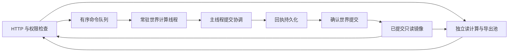

# 在线服务多核 CPU 与大内存适配

日期：2026-10-27（北京时间）。状态：用户已在 Q9 确认完整方案；首批代码及 Linux / Windows 实机验证完成，已进入生产验收。批量会话问题的处理见 [修复记录](../fixes/2026-10-27-batched-session-admission.md)。

实现与验证记录见 [在线资源适配验证报告](../performance/2026-10-27-online-adaptation/README.md)，配置及资源边界见 [运维说明](../RESOURCE-ADAPTATION.md)。

## 目标与已确认范围

服务器配置提高时，在线服务能够使用更多可用 CPU 与内存，提高实际计算吞吐和访问响应能力。资源利用以有业务负载时的处理能力为依据，不以空闲时占满 CPU 或内存为目标。

第一轮用户已确认：

1. 只优化在线服务；离线沙盘、标定和回放工具不属于本次优化范围。历史命令回放仍是正确性验证的一部分。
2. 默认自动适配实际可用 CPU 和内存，允许管理员手动设置上限。预留系统资源，内存紧张时收缩后台任务与缓存。
3. 同时支持 Linux 和 Windows，并验证受容器资源限制时的行为。

第二轮用户已确认：

4. 同时优化在线核心计算与后台任务：核心包括居民动作、日结算、状态复制和命令回执；先测量，再在保持规则、提交顺序与回放一致的前提下优化。
5. 模型行动频率、模型费用预算与单个居民程序的执行限额继续由现有独立配置控制，不随硬件扩容自动放大。
6. 资源紧张时优先保障居民行动和世界结算；重型查询、报表与历史导出可以有界排队，队列满时明确提示繁忙；收缩缓存和后台并发。

第三轮用户已确认：

7. 采用常驻世界计算线程与独立计算池。世界命令仍按序提交，对外接口保留；同时优化核心路径的重复复制、哈希和提交。架构决定见 [ADR 0028](../adr/0028-adaptive-compute-single-world-commit.md)。
8. 默认服务内存软预算为有效内存的 75%，CPU 计算槽位预留约 1/8 核数余量（至少 1 核，单核退化）。缓存默认上限为服务预算的 10% 与 4 GiB 的较小值，管理员可调整；作为初值，经在线基准校准。

## 代码基线

2026-10-27 通过 `git ls-remote origin refs/heads/main` 核实 GitHub main 为 `609fd27245b1e95e4a9957a685c04827e5f4bebf`。2026-10-26 Windows 局域网部署记录采用相同基础提交，另有 Windows 持久化兼容补丁；其补丁是否已进入后续基线，实施前需单独检查。

当前会话目录 `/Users/mac/images/projects/as4` 的 HEAD 为 `31a398b`，且存在大量既有修改，不能直接当作最新程序实现基线。最新基础代码可只读核查于 `/Users/mac/.codex/worktrees/wechat-observation/as4`；本次设计文件保存在会话目录，不修改其他聊天的代码工作副本。

以下源码定位均针对提交 `609fd27`，不代表已重新测量生产服务器。

## 已核实事实

| 路径 | 当前行为 | 对适配设计的影响 |
| --- | --- | --- |
| `src/server-status.js:6`、`:48`、`:86` | 采样整机 CPU、内存和进程内存，每 5 秒更新；现有数据用于状态展示 | 需要区分整机资源与进程真正可用的资源，并建立预算与调度联系 |
| `src/runtime.js:113`、`:124`、`:128`、`:131`、`:133` | 新语义命令依次准备候选、持久化回执、提交候选 | 世界状态提交需要保持有序，不能让多个写者并发修改同一世界 |
| `src/e2/engine/cities.js:71`、`docs/adr/0022-per-city-mounting.md:18` | 三城通过同步临时挂载共享世界对象；挂载期间禁止 await | 三城不能直接当作三个独立世界并行结算 |
| `src/e2/engine/tick.js:40`、`:162`、`:189` | 每刻与日结算有固定执行顺序，最后进行全岛守恒校验 | 计算优化必须维持既有步骤、随机流及账本语义 |
| `src/command-receipt.js:7`、`:49`、`:69`，`src/store.js:46` | 每条新语义命令复制世界，计算前后哈希与差异；递归序列化涉及临时字符串 | 是核心 CPU、临时内存和 GC 的热点候选，需要测量占比后优化 |
| `src/e2/programs/executor.js:14`、`src/e2/programs/worker.js:8` | 居民程序用隔离子进程执行，但父线程同步等待；子进程、来宾内存和时限分别有上限 | 异步化需要重新设计等待与提交边界，增加整机资源不等于放大每个不可信程序的配额 |
| `src/history/exports.js:64`、`:72`，`src/history/zip.js:8` | 历史导出在单条 Promise 链中生成，压缩和部分哈希同步进行；已有固定历史边界 | 独立导出任务适合有界计算池；权限、任务发布和历史边界仍需核验 |
| `src/history/archive.js:142`、`:160` | 部分历史查询流式扫描分支文件并筛选、排序 | 可研究有界索引和缓存，键必须覆盖分支、范围、撤回与可见性 |
| `src/world-snapshots.js:43`、`:47`、`:52` | 快照在同一命令边界获取世界和日志，再打包压缩；存在多份文本峰值 | 优化读取、序列化和后台计算时必须保留一致边界 |
| `src/events.js:12`、`:51` | 事件环形缓冲为固定条数；启动恢复还会整文件读入事件文本 | 缓存应纳入内存预算；历史增长带来的峰值不能只靠扩大堆上限处理 |
| `src/shells/config.js:15`、`:59`，`src/shells/manager.js:209` | 模型并发已有独立槽位和预算；默认并发 4，上限 64 | 网络请求并发与本机 CPU 工作线程是不同限制 |
| `src/http/public.js:25`，`src/e2/rules/parser.js:234` | 公共概览只缓存当前版本，规则语法缓存采用固定条数 | 可评估有界缓存与命中率；不能把查询权限或业务限额当作缓存容量调整 |

本轮调查未连接生产服务器，尚未进行完整 HTTP 负载测试。当前生产规模、每工作任务峰值内存及不同核数的加速比例尚未证实。

### 有限本地计时

在最新基线、macOS、Node v24.16.0 下，12 位合成居民的在线 Runtime 普通 tick 中位数随合成历史记录增加而增长：世界约 208 KB 时为 10.596 ms，约 1.08 MB 时为 43.531 ms，约 3.69 MB 时为 153.945 ms。最后一组的候选准备约 23.976 ms、回执生成约 84.135 ms、状态提交约 39.561 ms，回执持久化约 4.545 ms。

这是固定小样本的核心路径诊断，未启用 HTTP 或模型，不能外推为生产容量或多核加速承诺。各组候选与回执应用后的哈希均一致。可复现脚本、初始 Node v22 调查和 Node v24 复核原始数据见 [性能证据](../performance/2026-10-27-online-baseline/README.md)。

## 已有设计约束

- `docs/adr/0004-capacity-protection-pause.md`：法律与结算必须完整执行；容量保护采用确定性状态与版本化配置。运行时资源调度参数不能直接改变历史规则的执行语义或静默跳过结算。
- `docs/adr/0022-per-city-mounting.md`：维持现有三城共享世界及同步挂载语义。
- 命令回执、快照、事件以及恢复后的世界状态保持对应关系；不能为提高吞吐提前公开尚未持久化的世界结果。

## 设计状态与待确认事项

已确定“在线核心与后台、自动适配、Linux 与 Windows、模型及程序限额独立、世界运行优先、常驻世界计算线程与独立计算池”。核心调查已完成，缓存一致性、提交前鉴权、故障恢复、配置生效方式及验收规格如下。

本轮全部八项选择已有回答，没有剩余产品或架构选择。本文将具体提交、恢复、资源与验证要求合并为可评审方案，用户已确认完整共同理解，按本文实施。

## 整体设计

### 计算架构

已确认方案：主线程负责 HTTP、鉴权、资源调度和唯一持久化提交协调；常驻世界计算线程保持权威世界，按顺序准备命令候选和回执；独立计算池处理固定版本的查询、导出和其他可分离任务。主线程持久化回执后，确认世界计算线程提交，更新只读查询镜像，再返回成功与发布事件。镜像仅用于读，不能成为第二个引擎写者。

世界线程与后台池共用 CPU/内存预算；图中每个世界只存在一条权威提交链。

考虑过保留主线程执行世界命令、仅将历史导出等交给计算池。这种方式改动较小，但耗时结算仍占用 HTTP 主事件循环，不能充分解决本次核心计算目标。

所选方案需要内部异步命令队列和调用迁移，保留对外 HTTP 协议。不能每条命令把完整世界复制到临时线程、再把完整候选传回主线程，否则会增加复制并保留主线程的全图提交成本。单个世界的有序状态更新仍存在串行部分，多核收益主要来自同时进行的世界计算、读计算和后台任务；核心命令本身还需要减少不变历史的重复复制、哈希与提交，不能承诺核数与单世界速度等比例增长。

排队命令在持久化前重新检查账号、居民管理权版本、实验暂停轮次和前置世界版本，防止排队期间权限或世界状态变化。已提交回执的命令不能因超时或线程重启重复执行；纯读任务才可在确认同一版本与权限后重试。

### 自动资源初值（已确认）

- 有效 CPU 取可用并行度、已知系统/容器 CPU 配额和管理员上限的交集。计算槽位按约 7/8 核数设置，至少预留 1 核的调度余量；单核降为一个计算槽位并限制后台任务。世界计算计入同一计算预算，不能在预算之外再无限增加线程。
- 有效内存上限 `M` 取物理内存、可识别系统/容器限制和管理员上限的最小值；服务内存软预算初值为 `75% × M`，覆盖主进程、计算线程、原生分配与受管子进程。
- 缓存默认字节上限为 `min(服务内存预算的 10%, 4 GiB)`，可手动上调；按需分配，不主动填满内存。排队任务同时限制数量、负载字节及等待时间，执行前才申请任务副本和结果缓冲。
- 准入同时检查服务预算、当前系统/容器余量和任务内存预留，优先淘汰缓存、停止派发后台任务并收缩后台并发。所有线程的 RSS 属于同一个进程，不能重复累加；受管子进程单独记账。
- 手动资源上限从服务配置读取，首版重启生效；运行时依据资源压力自动伸缩。声明预算、生效槽位、进程 RSS、各线程实际堆上限、缓存字节、排队情况与降载原因可在管理员运行状态中查看。

### 平台与运行时边界

保留当前 Node.js ≥20 的运行要求，通过能力检测兼容不同小版本；Linux 资源探测补充 cgroup v1/v2 的 CPU 与内存限制及祖先约束。`process.availableMemory()` 在 Node 20.13 才加入，`constrainedMemory()` 返回 0 不代表零可用内存；需有明确回退与探测来源。[Node 进程资源 API](https://nodejs.org/docs/latest-v24.x/api/process.html#processavailablememory)

Windows 普通主机使用有效并行度与系统内存探测。特殊 Job Object 内存约束和超过 64 逻辑核的机器不能仅依赖 Node API 宣称已完整识别；未确认约束时采用保守并发、允许显式上限，并在管理员状态说明探测覆盖。平台专项测试必须区分真实验证与模拟验证。[libuv 并行度说明](https://docs.libuv.org/en/v1.x/misc.html#c.uv_available_parallelism)、[Windows Job 内存约束](https://learn.microsoft.com/en-us/windows/win32/api/winnt/ns-winnt-jobobject_extended_limit_information)

V8 堆上限与服务总内存软预算分开控制。不能只提高父进程 `--max-old-space-size` 后假定每个工作线程仍遵循自己的较小堆限额；该参数会覆盖工作线程的旧生代设置。工作线程限制也覆盖不了 Buffer、ArrayBuffer 和全部原生内存，需采样实际堆与整体 RSS 并进行任务准入。[Node Worker 资源限制](https://nodejs.org/docs/latest-v24.x/api/worker_threads.html#new-workerfilename-options)

## 验证准备

可复用 `test/command-receipt.test.js`、`test/persistence.test.js`、`test/e2-determinism.test.js`、`test/program-services.test.js`、`test/world-snapshots.test.js` 的既有正确性覆盖。新增验证应覆盖有效资源探测、预算约束、任务池背压、缓存权限与失效、工作线程故障，以及固定在线负载下单核和多核的吞吐、延迟及峰值内存对比。

离线 `scripts/q60-performance.mjs` 可作为既有状态哈希与守恒诊断的参考，不将其成绩替代在线服务的性能验收。

## 实施与正确性规格

### 有序命令与提交

生产环境的世界变更统一经过异步提交接口；HTTP、运行器、刻调度、暂停/恢复、模型额度预留与退款均不得绕过队列。保留直接引擎和离线测试的同步能力，但禁止在线线程模式下混用同步写入口。低配内联执行也通过同一提交协议，只在启动或完成恢复后选择模式。

提交协议为：队列接纳请求 → 检查当前资格并分配候选命令序号 → 世界线程基于已确认版本准备候选和回执 → 协调者复核权限及前置版本 → 持久化回执 → 确认权威世界提交 → 原子更新只读镜像 → 依原顺序发布事件和观察通知 → 返回结果。前一条命令完成提交确认后才开始下一条有依赖的世界命令。

权限复核与回执持久化之间不得插入可改变资格的异步等待。异步排队期间发生的账号停用、居民过继、管理员撤权、实验暂停轮次改变等，必须在持久化前得到处理；未获资格的候选直接丢弃。纯内部计算故障不写成居民自主选择的失败动作。

保持 `events.append → wakes → tick/快照 → onCommand` 的原有可观察顺序。事件与观察通知只描述已持久化且已提交的状态，查询镜像更新在一次同步发布边界内完成。待发布通知具有命令/事件身份，恢复时不能重复扣费、重新唤醒或制造第二次居民行动。

### 读任务、缓存与大历史

任务携带世界、纪元、分支、命令截止编号、事件截止序号以及撤回/权限相关版本；结果返回对应的截止信息。公共查询按已提交版本缓存，私有结果在返回和下载前重新核验当前访问权。大内存中的缓存不能跨账号、过继、分支或撤回版本泄露记录。

历史导出任务可以在不同用户间并行，继续遵守现有每用户在途限制。管理员快照获取同一已提交命令边界的世界与日志范围，压缩和哈希在可分离计算中完成；采用流式日志与有界缓冲，不能将“压缩包很小”当作内存预留依据。

计算任务需要同时限制输入、结果、驻留副本和队列负载；历史按需建立可重建的索引，不因大内存而把无限历史全文复制到每个线程。后台任务分块并设置截止时间，以便世界队列繁忙时停止派发并及时退让。

### 核心路径优化边界

- 用单一提交入口维护已提交状态的规范化哈希；启动恢复时先核验，不单凭 `commandN` 缓存可变对象。
- 评估复用已提交回执的 `after` 作为下一条命令的 `before`，减少重复哈希；前提是查明所有确定性状态变更入口和外部状态写入，并保证不存在旁路修改。
- 减少差异计算中的重复序列化，对不变历史使用可验证的分支复用。只对保证不可变的镜像/投影对象缓存规范化文本，保持原有排序规范和 SHA256 格式。
- 保留候选隔离、异常回滚和对象别名语义。不能直接删除整个候选复制，也不能将普通 JSON 路径补丁当作权威世界对象图提交的等价替代；居民稳定对象身份、新旧共享引用均需覆盖。
- 居民程序继续在原隔离环境和单次限额内运行。世界队列的串行依赖仍保留；独立纯计算只有在输入版本和提交条件可验证时才调度到其他计算槽位。
- 资源预算不进入世界随机流、法律计算容量或历史规则语义。更多硬件提高调度能力和吞吐，不自动提高模型费用或居民程序的单次执行配额。

### 故障、降载与关闭

落盘前计算线程失败，丢弃尚未提交候选；落盘后失败，以快照与已持久化回执恢复，不能重新执行有时限结果的居民程序。持久化结果或提交确认不明时停止新的世界写入并恢复核验，不能盲目重试。

只读任务失败可以在相同版本和重新授权后有限重试。服务关闭时停止接纳新任务、结束后台任务、完成或明确恢复正在提交的命令，保存与已确认日志边界对应的快照，再关闭线程。任何回退均保持一个权威世界和一个写入者。

压力控制先清缓存、暂停新后台任务和降低后台并发，随后按有限队列接纳世界请求；不能通过跳过法律、截断结算或修改实验时间来释放资源。若剩余内存不足以安全准备下一个命令，应拒绝接纳并给出明确状态，保留可恢复的数据，不能在已开始的状态变更中途静默降级。

### 本次交付与验证

实施在从最新已核实主线创建的独立工作副本完成，重新核对 Windows 兼容补丁；保留当前目录及其他聊天的既有修改。交付资源探测/预算、世界计算线程、后台计算池、读缓存/索引、核心开销优化、运维配置与验证结果。部署不属于本次已经确认的范围。

| 编号 | 场景 | 验收证据 |
| --- | --- | --- |
| A1 | 内联与计算线程执行同一输入序列 | 状态、随机流、账本、命令结果和事件相同；旧回执与既有快照可恢复 |
| A2 | 核心命令与三城结算 | 世界命令有序；对象身份与共享引用、保护暂停、失败回滚和守恒验证通过 |
| A3 | 排队期间撤权、过继或暂停 | 未授权或过时命令不持久化；私有查询和下载重新核权 |
| A4 | 落盘前、落盘后、提交确认期间故障 | 恢复到唯一已确认日志分支，不重复执行程序、不重复扣费或行动 |
| A5 | CPU、内存及容器边界 | 按实际限制和手动上限调度，含小数 CPU 配额、单核、低内存、未知约束与能力缺失回退 |
| A6 | 后台积压与内存压力 | 任务数、负载字节、等待时间和缓存有界，后台退让，世界服务继续响应或明确拒绝接纳 |
| A7 | 固定历史边界的并行查询、导出和快照 | 数据来自同一已提交边界，分支/撤回/权限隔离成立，快照可校验恢复 |
| A8 | 核心增长负载 | 在相同机器与 Node 版本比较，候选/回执/提交开销有可重复改进，不能以任务移出 HTTP 线程替代单命令耗时对比 |
| A9 | 单核与多核在线混合负载 | 报告吞吐、请求 P50/P95、事件循环延迟、分阶段耗时、CPU 与峰值内存；有独立计算积压时真实运行多个计算线程，多核收益可复测 |
| A10 | Linux 与 Windows | 各自完成配置、持久化、线程启停、恢复与 HTTP 验证；真实系统结果与资源探测模拟结果分别记录 |

性能负载使用合成且合法的世界数据、固定种子和确定的模拟模型结果，包含增长历史、居民行动、日结算、查询与导出；不通过付费模型吞吐衡量本机 CPU 加速。先记录改造前后同负载结果，再评估不同核数和内存限制；若当前机器无法提供某个硬件档位，明确未实测，不用配置数值冒充实际扩展能力。

## 最终共同理解确认

用户已逐项确认八项选择。用户在 Q9 明确回复“确认完整方案，开始实现”，已按本文推进程序改造与验证。

实现位于独立工作副本 `/Users/mac/.codex/worktrees/adaptive-online-compute/as4`、分支 `codex/adaptive-online-compute`。验证结果另行汇总，未执行部署。
