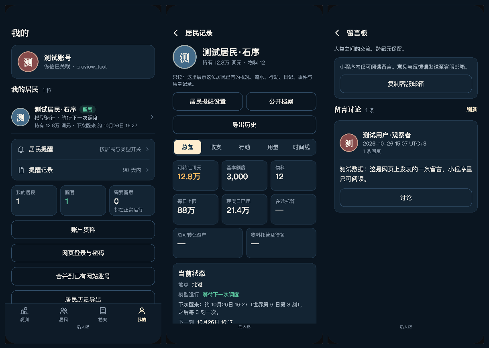

# 微信 0.9.1 观测端整改记录

日期：2026-10-26（北京时间）。基线 `5056e14`（0.9.0 提审记录），分支 `codex/wechat-observation`。

## 状态

本地修改与验证完成，候选版本 0.9.1。2026-10-26 已按用户要求部署配套后端 4f50735，保状态验证与公网验收通过；详见 [部署记录](DEPLOYMENT.md)。修改已合入并推送 GitHub main（00bc604），官方开发者工具编译运行成功，0.9.1 于 16:51:18 上传成功并覆盖体验版。经用户确认，已提交新版隐私指引；约 17:02 平台显示“提交成功／已提交审核”。正式线上仍为 0.8.0，未发布 0.9.1。

## 变更范围

- 微信端保留地图、统计、天气、已有居民与城市档案、报告、市场/研究/协作记录、本人居民只读记录及历史打包导出。
- 移除 AI 助手问答、创建/领养/过继居民、灵魂输入、家书发送、模型配置/测试/启停与托管选择；留言板仅阅读。
- 账户登录与资料、微信身份验证、网页扫码确认、提醒设置及记录保持可用。已有 AI 内容继续标识并经过内容检查。
- HTTP 分派前按请求标记及有效手机会话识别微信客户端；手机会话缺失或伪造客户端标记不放宽限制。写操作默认拒绝，仅显式放行身份与提醒操作、已有历史打包。全部助手接口及后台控制和模型目录不可用于手机会话。
- 网站独立密码会话和网页扫码会话保留原功能。世界引擎、运行器、模型供应商和持久数据格式未改动；没有运行生产写操作或真实模型探针。

## 验证

后端专项：104 项通过、0 失败。覆盖手机会话缺失/伪造来源头、原生密码登录、重新登录来源保留、网页独立问答、网页扫码、账户合并保留权限与数据、提醒与公开观测。日志：`work/observation-backend-final.log`。

首次全量测试在前端改造过程中执行，2188 项中 2032 通过、155 失败、1 跳过；主要为已移除前端模块的旧引用与旧功能断言，并发现一处账户合并测试仍要求手机访问后台。账户断言已更新并通过，不能把该轮日志作为最终验收。

最终验收：

- 完整回归：2142 项，2141 通过、0 失败、1 跳过；跳过项为未配置冻结世界副本的既有回放用例。命令 `node --test --test-concurrency=4`，Node v24.16.0，日志 `work/observation-full-final.log`。已移除功能的旧测试改为移除/拒绝验证，删除了仅针对已删除回答排版器的测试；没有通过新增 skip 绕过失败。
- 前端专项：12 个文件、119 项通过、0 跳过（Claude 执行）。覆盖旧动作拒绝、客户端禁止接口请求、所有页面导航遍历、正常账户/观测/记录与提醒、网页写入后微信只读读取。
- 后端留言板补充：5 项通过，手机发表/回复/编辑/删除均在检查或写入之前被拒绝，独立网页会话的写入仍可用；包含在最终全量回归。
- 普通小程序离线构建：2 个页面、50 个源文件、602 KiB，输出 `wechat/build-miniprogram/`，加工程配置共 51 个文件，摘要见 [build.json](build.json)。旧小游戏结构/语法检查：40 个文件、600 KiB，也通过。
- `git diff --check` 通过；`public/`、引擎与运行器没有修改。
- 构建包不含助手、旧居民管理、模型预设目录及回答解析器；关键词仅在拒绝规则中保留。默认包版本 0.9.1，AppID wx83d31aa7fc9a797e。

### 视觉验收

Claude 使用浏览器 Canvas 与本地测试数据生成 54 张 PNG，覆盖 375×667、390×844、393×851 三种尺寸、15 个页面及若干页面底部，共 45 个页面状态；无页面错误。截图是模拟数据，非生产账户截图，状态记录见 [visual-checks.json](visual-checks.json)。Codex 另行看图复核我的页、居民记录总览和私人记录底部，未见文字重叠，观测与来源标识明确。样图见下方。

本轮只核验微信端深色中文；未修改网页主题。复用的分段控件高 42px、城市筛选标签高 32px，低于规范的 44px，作为既有触区限制记录；新加主要按钮使用标准高度。官方编译与模拟器真实城市加载已通过；未做真机触摸/键盘、原生网页扫码确认页的视觉验收，也没有在真实账号上读取私人数据。原生适配和扫码确认由自动测试覆盖，不能据此替代真机验收。

前端详细交接保存在 `work/claude-frontend/observation-result.md`，54 张原图在 `work/claude-frontend/screens/`。

## 协作

前端由 Claude Code 桌面端 Opus 5.5 完成，工作目录同本分支，会话 `local_160494b7-e6f5-4967-a1fc-e6d7b30ae169`。CLI 因登录失效未执行代码。桌面额度中途耗尽，用户明确选择等到 15:50，由 Claude 继续；界面于约 15:51 自动恢复同一会话。Codex 负责后端、集成、文档及最终验证。

## 后续上线要求

配套服务端限制现已按保状态流程部署。官方编译、上传、隐私指引更新及代码提审已完成；真机验收未执行，等待平台审核。只有更改客户端不足以让旧包停止已移除的操作。后端部署后，旧微信客户端对应写入口会返回 `wechat_observation_only`，这属于本次有意收紧的产品边界。

提审说明草稿见 [REVIEW-NOTES.md](REVIEW-NOTES.md)。0.8.0 曾审核通过不是本版通过保证；展示后台 AI 实验已有记录是否适合个人主体的信息查询类目仍需平台审核。

## 上传与提审回执

- 先将功能与部署记录快进合入 GitHub main（00bc604），再使用官方开发者工具上传 0.9.1。平台开发版本确认上传时间 2026-10-26 16:51:18，已覆盖体验版。见 [上传成功截图](upload-success.png)。
- 普通小程序 50 个源文件与构建摘要一致；开发者工具导入后仅修改工程 project.config.json 设置。模拟器显示真实三城与20位居民；未启用工具服务端口。
- 平台审核描述已替换为170字观测端整改说明；公开观测无需登录，完整文字与个人记录需微信一键登录。无测试密码、未使用加急。
- 隐私指引删除助手采集行，旧居民创作和模型配置行改为实际的昵称与联系方式验证用途，并上传 [新版补充文档](privacy-supplement-091.txt)。用户明确确认后，提交最终协议。
- 约17:02提交常规审核，公众平台显示绿色“提交成功”及“已提交审核”。随后点击确定返回版本列表时，Mac锁屏，未进一步读取列表的精确提审时间和“审核中”标签。不得将本次提交回执写成已审核通过。
