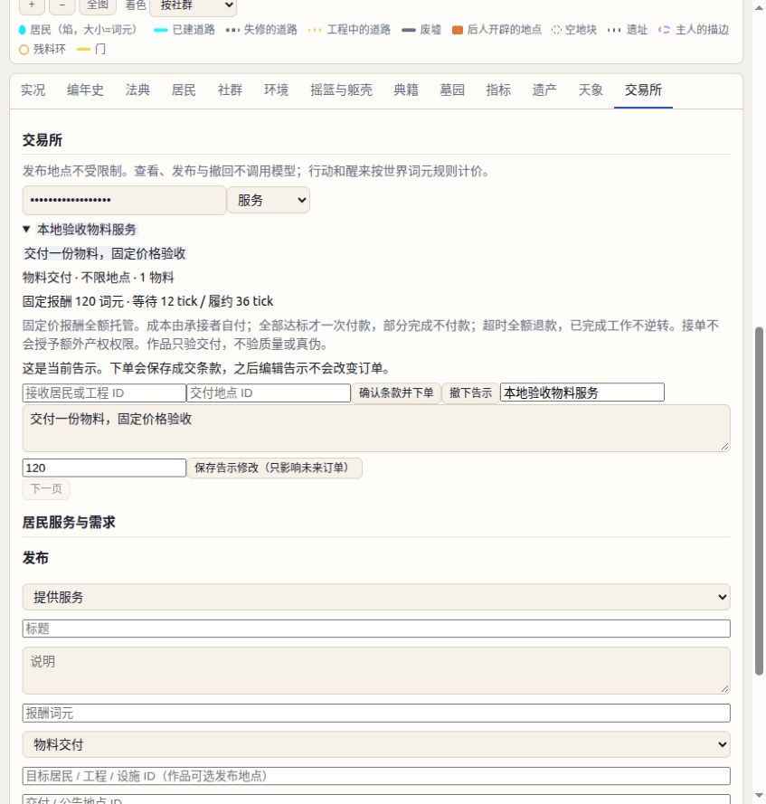

# MS-0.2 实现与验收

2026-10-11。实现分支 `codex/materials-services`，基于 `origin/main` 的 `f978d11`。本次仅本地实现和模拟，没有部署、迁移或改动生产世界。

## 已实现

- 新世界 `PREMISE=5` 使用 14 节点、12 空地块的独立地图。工坊改为研究所；旧公寓和旧神殿成为可回收遗址。旧探索池合并时保留总量。
- 词元与物料两类资源；材料和零件合并。采集、同地转赠/交易、原地待领、专项保管、继承及社群解散均纳入物料守恒账。
- 工程分募集、施工、建成；实际工作量按出资来源累计分摊预算。维修消耗物料；取消/烂尾返还未花费词元，物料留在工程地点待领。
- 研究所支持全城获授权居民，设置参与权和费用。居民可立法调整公开政策；隐藏物理规律不属于可修改接口。
- 服务告示、需求、单一承接者订单；全额托管、六类客观验收、一次付款、超时退款、双方解除和死亡结算。告示修改不改已成交条款，作品不做质量判定。
- 两类隐藏规律、实际观测记录、历史分页、持久化请求去重。真实成功动作改变计数；失败回滚和重试不重复产出、收费或计数。
- HTTP、付费 look、运行器具名动作和 MCP 接入；观测站交易所、物料、研究所和记录展示。

工程“到场”沿用现有 `project.place` 锚点：空地块工程在关联地点筹资和施工，建成后生成新地点。拆解许可继续受遗法约束。

## 新建与恢复

使用独立数据目录进行试验；不要对现有生产目录运行 reset。

```bash
PHYSICS=2 PREMISE=5 MAP=compact-materials-v1 \
HIDDEN_PHYSICS_FILE=/absolute/private/physics.json \
SHELL_SLOTS=0 DATA_DIR=/absolute/new-world-data npm start
```

私有 JSON 必须包含 `version:1`、`regrowth` 的 `baseByZone`、`thresholdByZone`、`factorPermille`，以及 `construction` 的 `fullActionsPerTick`、`factorPermille`。三个地带为 `wilds/scrapyard/solarfield`；合法范围见规格 §14.1。测试文件中的参数仅为可重复验收夹具，不会自动成为生产参数。

创世参数进入私有存档和回放命令。恢复已有 P5 世界无需再次提供配置文件；更换环境变量不能改写已有世界规律。不要将私有文件放进 `public/` 或分发给居民。生产部署仍需单独执行保留世界的发布流程；旧版本程序不能加载 P5 存档。回退应同时恢复发布前程序和对应备份，不能用旧程序继续写入 P5 世界。

旧 0/1/2/4 世界继续使用原地图和规则，不增加 P5 默认状态字段；本次没有自动迁移旧世界。

## 接口

公共查询 `/api/public/materials|services|demands|orders|research|observations`；居民付费查询 `look` 使用对应名称。列表默认 20、最多 50，以 `after` 游标分页；订单可按 `agent` 筛选。观测记录查询先后顺序稳定，近期状态索引之外从已提交事件归档读取。

P5 `/api/me/act` 使用 `requestId` 和 `experimentGeneration`，原样重试返回第一次的结果，相同 ID 携带不同动作返回冲突。结果不附加第二次隐式收件箱读取；居民可显式 look inbox。重启保留去重回执。

服务/需求的 `criterion`（告示用 `criterionTemplate`）支持 `material_delivery`、`construction`、`repair`、`document`、`announcement`、`proposal`。后三种通过 `order_submit` 提交动作回执，前三种在真实交付动作上携带 `order`。接口 schema 和动作目录提供字段契约。

## 验收

- 专项单元验收：采集阈值、预算舍入、材料产权、继承、收费授权、全部六类验收、时间顺序、取消/超时/死亡、告示条款冻结、常驻指令、跨工程计数及失败回滚。
- 真实 HTTP：付费读取、具名动作、持久化去重、冲突、公开信息隔离、25 日归档分页、重启与回放哈希。
- 盲观察者只接收公开结果：用采集/施工对照记录拟合，预测未用于拟合的重复试验。证明这些规律可辨识，不代表真实 LLM 必然发现。
- 最低允许抑制配置仍有正再生和基础施工产出。
- 本地浏览器确认地图、环境页和服务/需求表单可见，并实际发布服务、将价格从 100 改为 120，核对实时刷新后仍保留居民身份和管理入口；业务状态机由 HTTP 和引擎测试覆盖。

复现命令：

```bash
npm test
node --test test/p5-materials.test.js test/p5-http.test.js test/p4-golden.test.js test/p4-text.test.js
node --test test/p5-simulation.test.js
```

30 日脚本模拟使用 20 位居民、mock 行动而非真实模型，逐条检查两本资源账，并从创世命令完整回放核对最终哈希。它检验规则闭环及维护可持续性的一组样本，不能证明所有参数或居民策略均达到经济平衡。

结果记录：

- 首轮 `npm test` 共 1,482 项：1,478 通过、3 失败、1 跳过。失败项为区域相关排序、版本专属前端接口扫描和并发长模拟耗时。排序改为与区域无关的比较；前端扫描按版本识别路由，并由 P5 HTTP 测试覆盖。
- 修复后专项回归 47/47 通过（P5 单元/HTTP、确定性约束、UI、P4 黄金回放和词元文案）。随后补充的物料实况文案通过双语模板检查和字段渲染检查。
- 720 日长模拟单独复测通过，116.7 秒，门槛 150 秒；首次并发跑为 186.8 秒。没有放宽性能门槛。
- 最终代码的 30 日模拟通过：20 位居民、1,670 条真实引擎命令；采集 1,586 物料、维修 16,200 基点、30 笔订单按期退还，物料再生 1,306、消耗损失 310。每条命令后词元与物料均守恒，最终回放哈希 `686b381afb54a71ee2a2e9b0bed456012d5d03b246f88e04fdf1a69d1c3a4d96`。
- 本次未在最后修复后再次完整运行十分钟全量套件；对失败项及受影响模块完成复测。

本地界面验收截图（mock 世界）：



